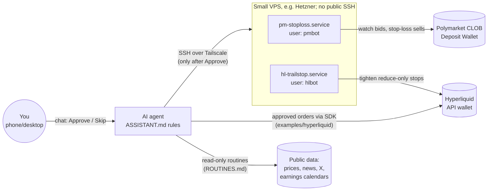

# ai-trading-copilot-kit

A small, **human-in-the-loop** trading setup you can rebuild with an AI agent
(Grok Bot, Claude, Cursor, ...). The AI researches and proposes; **you approve every
single order with one tap**. Two tiny server services protect open positions:

| Part | What it does | Places orders? |
|---|---|---|
| `ASSISTANT.md` | System prompt / bot rules for your AI agent | Only after your in-chat Approve |
| `ROUTINES.md` | Read-only scheduled checks (morning update, earnings alerts, ...) | **Never** |
| `polymarket-stoploss/` | Polymarket stop-loss bot (`pmbot`): Polymarket has no native stops, so this watches your bets and sells when a stop is hit | Only stop-loss **sells** (and `pmbot buy` when you type YES) |
| `hl-trailstop/` | Hyperliquid trailing-stop helper (`hltrail`): only ever **tightens** existing stops | Only moves existing stops; dry-run by default |
| `examples/hyperliquid/` | Small SDK scripts: check account, short + stop, take-profit, grouped entry + TP/SL, move a stop | Yes, each asks you to type YES |

Inspired by the "AI proposes, human approves" idea in projects like
[cryptuon/polybot](https://github.com/cryptuon/polybot).

> **Not financial advice.** This is a hobby setup for learning. Use small amounts you can
> afford to lose (the defaults are ~$10 per Hyperliquid trade and $2-5 per Polymarket bet).
> **Polymarket is geoblocked in some countries. Obey your local law: do not use a VPN, proxy
> or a server in another country to get around a block.** The bot checks Polymarket's
> geoblock endpoint and refuses to trade if blocked.

## Architecture



## Safety model

- **Every order is approved by a human in chat.** Routines are read-only and never place,
  modify or cancel orders. Order scripts also ask you to type `YES`.
- **Hyperliquid API (agent) wallet.** It can trade but **cannot withdraw**. Your main wallet
  key is never on the server and never given to the AI. Only the API wallet key is used.
- **Polymarket bot key holds small funds only.** Polymarket's Deposit Wallet is owned by a key
  the bot creates on the server, so that key *can* move the money in it. Keep only what you
  are willing to bet there (e.g. $20-50).
- **Tailscale-only SSH, key-only auth.** Port 22 is closed to the internet; root password
  login is disabled.
- **Separate Linux users** (`pmbot`, `hlbot`) with `chmod 600` key files and hardened systemd
  units (`NoNewPrivileges`, `ProtectSystem=strict`, limited write paths).
- **Dry-run first.** Both services start with `dry_run: true` and only log what they would do.
  Switch to live after a day or two of logs look right.
- **Confirm delay.** A Polymarket stop sells only after the best bid stays at/below the stop
  for 3 minutes (10 minutes during a live sports game), so one-minute spikes don't sell you out.
- **Hard caps.** `pmbot buy` refuses bets above `max_buy_usd` (default $5) and below
  Polymarket's 5-share minimum. `hltrail` never opens, increases or flips positions and never
  creates a stop where none exists.
- **No secrets in git.** See `.gitignore`. Keys live only in `~/.pmbot/` and `~/.hltrail/env`
  on the server.

## Requirements

- A small Linux VPS (Hetzner CX22 or similar, Ubuntu 24.04 / Debian 12), Python 3.11+
- A [Tailscale](https://tailscale.com) account (free) for private SSH
- Polymarket account in a country where it is allowed; some USDC on Polygon (a few dollars of
  POL for gas only if needed)
- Hyperliquid account with a little USDC; an API wallet created in the app
- An AI agent that can run shell commands over SSH (or you run the commands yourself)
- Optional: Telegram bot for instant sell alerts

## Quick start

1. Read `SETUP.md` (or give it to your AI agent: "follow SETUP.md step by step, ask me before
   anything that touches money").
2. Paste `ASSISTANT.md` into your agent as its system prompt / bot description.
3. Create the read-only routines from `ROUTINES.md`.
4. Start a picks log from `picks-log.example.csv`.

```bash
# on the server, after SETUP.md
sudo -u pmbot pmbot status          # what the stop-loss bot sees
sudo -u hlbot hltrail status        # what the trailing helper would do
journalctl -u pm-stoploss -f        # live logs
```

## Running the tests

No network or keys needed.

```bash
python3 -m venv /tmp/kit-venv
/tmp/kit-venv/bin/pip install -r polymarket-stoploss/requirements.txt -r hl-trailstop/requirements.txt
cd polymarket-stoploss && /tmp/kit-venv/bin/python -m unittest discover -s tests -v && cd ..
cd hl-trailstop && /tmp/kit-venv/bin/python test_hltrail.py && cd ..
```

The Polymarket tests use the public Hardhat/Anvil test account #0 address to check the
Deposit Wallet derivation; it is a well-known test address, not anyone's wallet.

## Public contract addresses in the code

`polymarket-stoploss/pmapi.py` contains Polygon contract addresses from
[docs.polymarket.com/resources/contracts](https://docs.polymarket.com/resources/contracts)
(pUSD, USDC.e, native USDC, the pUSD onramp, Conditional Tokens, Position Manager,
Neg Risk Adapter). These are public; verify them against the docs before going live.

## Alternative: Hyperliquid native trailing stop

Hyperliquid also supports a native trailing-stop order type that runs on the exchange itself
(works even if your server is down):
<https://hyperliquid.gitbook.io/hyperliquid-docs/support/faq/trailing-stops>.
At the time of writing the official Python SDK did not expose it, which is why `hl-trailstop`
exists. If your SDK supports it, prefer the native order.

## Layout

```
ASSISTANT.md   ROUTINES.md   SETUP.md   picks-log.example.csv
polymarket-stoploss/   pmbot CLI + stop-loss service, tests, systemd unit, config example
hl-trailstop/          hltrail trailing-stop helper, tests, systemd unit, config example
examples/hyperliquid/  order examples (each places REAL orders after you type YES)
```

## License

MIT, see `LICENSE`.
